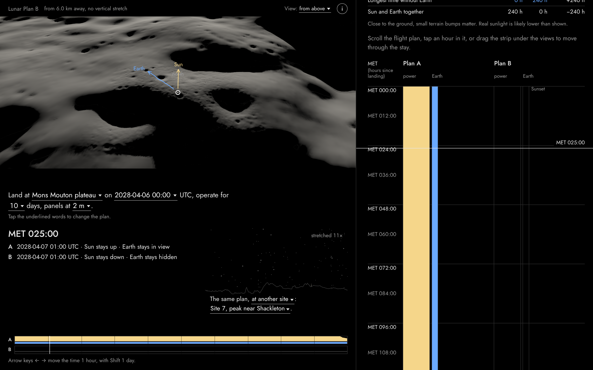

# LunaricB

One screen that compares two landing plans for the lunar south pole: where the Sun and Earth sit relative to the real terrain horizon, and what that means for power and direct-to-Earth contact.

NASA Space Apps 2026, challenge "Lunar Landing Site Navigator". Made during the event, 14 and 15 November 2026.

**Live page: https://lunarplanb.vercel.app/**



## What it does

You write plan A as a sentence: where to land, when (UTC), for how many days, and how high the solar panels stand. Plan B is the same plan with one thing changed: one day later, one week later, 29.5 days later (one lunar day), or at another of the seven sites. For every hour of both stays the page works out, over the real terrain of each site:

- how much of the Sun's disc is above the terrain (the power number, 0 to 100 %),
- whether Earth's centre is above the terrain (direct contact with Earth),

and shows it four ways:

- **a verdict in one sentence**, and a mission summary table (hours of sunlight, average share of the Sun's disc, longest time with no Sun, hours with Earth in view, longest time without Earth, hours with both), A beside B;
- **a flight plan**: time runs down the page, one row per hour, written "MET 096:00" (hours since landing, as in an Apollo flight plan), with a gold power band and a blue Earth band for each plan;
- **the view from plan A's site** at the moment under the cursor: the real skyline, the Sun, Earth with its true phase and its real face, the stars at their real places, and the ground lit and shadowed from the Sun's direction. Plan B's view sits beside it, smaller;
- **a thin strip with the whole stay of both plans**, to jump to any moment.

Every number comes from one calculation (a Python reference, matched by the browser code). The pictures are for seeing the place; they never change a number.

## Using the page

- The plan is a sentence. Every underlined word with a small triangle can be changed. The landing time always reads `2027-03-01 00:00` (24-hour clock, UTC). A click or tap on it opens a calendar with the hours; it can also be typed, and typing changes only the digits (the marks between them stay, and the caret steps over them). In that box the up and down keys step the part under the caret.
- The address can open the page at a plan, a moment and a view, for example `?site=mouton&date=2028-04-06T00:00&days=10&panels=2&b=site07&met=25&view=above`. `site` is a site id (see Sites); `date` the landing time, UTC; `days` 1 to 60; `panels` 2 or 5; `b` is `day`, `week` or `lunarday` (one day, one week or 29.5 days later) or a site id (at that site); `met` the hour since landing; `view` is `panorama`, `above` or `surface` (the 3D views only where the device passes the speed check below). A value that does not fit is left out.
- Time is the scroll position of the flight plan. The strip under the views shows the whole stay for both plans: tap it to jump to a moment, drag along it to run the time. A tap on an hour of the flight plan brings that hour to the cursor.
- Arrow keys left and right move the time 1 hour, with Shift 1 day; Home and End go to landing and to the end of the stay. While a box of the sentence has the focus the arrow keys edit that box; Escape, or a click on the view or the flight plan, hands them back to time.
- "View:" over the view of plan A chooses how to see the site:
  - **panorama** (the page opens with it): all 360 degrees around the site, with the vertical scale stretched so the low skyline can be read; the stretch is always written on screen. Works on every device.
  - **from above**: a 3D model of the terrain, seen from a camera circling the landing point and looking down by 35 degrees, 6 km away to start. Drag sideways to turn; use the wheel or two fingers to come nearer or go farther (0.8 to 20 km). The landing point is marked, thin arrows on the ground point toward the Sun and Earth (dashed when that body is behind terrain as seen from the landing point), and a short line points north. Shadows move as the time moves.
  - **stand on the surface**: the same model seen from panel height, 70 degrees wide, with the level sight line 40 % down the picture. Drag sideways to turn.

  Neither 3D view has any vertical stretch. A finger moving up or down on the picture still scrolls the page, that is, the time. Plan B's view is always the panorama.
- The 3D views load last, in the background. Before offering them the page checks that the device can draw them: once the page and all its data have arrived and the browser is idle, it draws two pictures that are not counted and then times 30 (one per screen refresh, so the page stays responsive). The 3D views are offered when the median is 60 ms or less. Without WebGL2, or above that, the page stays with the panorama; a device whose first five pictures all take more than 180 ms is stopped there. Adding `?3d=off` or `?3d=force` to the address overrides the check.

## Three moments to try

Each link opens the page at that plan, that moment and the view from above. By hand: set plan A's sentence as given (the days stay at 10 and the panels at 2 m), set plan B's choice, move the time to the given MET (tap the strip, or Shift and right arrow for whole days, then the right arrow for hours), and pick "View: from above". In all three the Sun stands 3 to 4 degrees above plan A's site, high for the south pole, so the shadows of crater rims run long and sharp.

| | Plan A: land at, on (UTC) | Plan B | Time | What it shows |
|---|---|---|---|---|
| 1 | Mons Mouton plateau, 2028-04-06 00:00 | at another site: Site 7, peak near Shackleton | MET 025:00 | The whole difference a site makes. A: Sun 99 % of the stay and Earth in view all 240 hours. B: no Sun and no Earth for the whole stay. Verdict: "Plan A is better on both counts: 99 points more sunlight and 240 more hours of Earth contact." Sun 3.1 degrees up at A. |
| 2 | Mons Mouton plateau, 2028-11-30 00:00 | one week later | MET 077:00 | The same place, one week apart. A: Sun 99.8 %, Earth 228 h. B: Sun 30.4 %, Earth 185 h. "Plan A is better on both counts: 69 points more sunlight and 43 more hours of Earth contact." Sun 3.85 degrees up at A. |
| 3 | Malapert massif, 2027-01-26 00:00 | one week later | MET 006:00 | A trade-off. A gets sunlight (68 % against 0 %), B gets Earth (232 h against 98 h): one week later the Sun has gone below Malapert's horizon but Earth has risen. Sun 3.2 degrees up at A. |

Links:

1. https://lunarplanb.vercel.app/?site=mouton&date=2028-04-06T00:00&days=10&panels=2&b=site07&met=25&view=above
2. https://lunarplanb.vercel.app/?site=mouton&date=2028-11-30T00:00&days=10&panels=2&b=week&met=77&view=above
3. https://lunarplanb.vercel.app/?site=malapert&date=2027-01-26T00:00&days=10&panels=2&b=week&met=6&view=above

These were found by scanning all seven sites, every landing day from 2027 to 2029 and every choice of plan B with the Python reference, for hours when plan A has the whole Sun and Earth in view, plan B has neither, the Sun stands high at A, and the two plans differ most over the whole stay.

## How it works

- **Sky.** One table from NASA/JPL Horizons: the Moon seen from Earth's centre, hourly from 2026 to 2030, with the sub-solar and sub-Earth points on the Moon and the distances (quantities 14, 15, 19, 20, frame MOON_ME). The direction of the Sun and of Earth from any site follows from those points by geometry; for Earth the site's own position on the Moon is taken into account (parallax, up to 0.26 degrees). Azimuth is clockwise from north.
- **Terrain horizon.** For 720 directions around each site the page has the angle of the terrain horizon, worked out beforehand by walking along great circles over three LOLA elevation maps: the site's 5 m map for the first 5 km, an 80 m map to 100 km and a 240 m map to 300 km, on a sphere of 1737.4 km. The distance of the terrain that sets each horizon value is stored too. Negative horizons (looking down off a peak) are kept.
- **Power and Earth contact.** The power number is the visible share of the Sun's disc, cut into 32 vertical slices, each against the horizon at its own azimuth. Earth contact counts when Earth's centre is above the horizon.
- **Panorama ground.** Which way the ground faces below the skyline (one point per degree of azimuth and 0.2 degrees of elevation), lit by the Lommel-Seeliger law, the usual first model for the dark, dusty lunar surface. When the Sun is down, Earthlight, with the exposure raised.
- **Real sky.** 2,887 stars from the Yale Bright Star Catalogue placed by the Moon's orientation (IAU model); Earth painted from NASA's Blue Marble, turned to the face that looks at the Moon and lit from the Sun's side.
- **3D views.** For each site, five square height grids, one inside the other (5 m within 250 m of the site, 20 m to 2 km, 80 m to 8 km, 160 m to 20 km, 960 m to 120 km), with the Moon's curvature in the positions (level ground 20 km away lies 115 m below the site's horizontal). Drawn with three.js: the same Lommel-Seeliger light, and cast shadows from shadow maps in two steps. Details below, under Validation.
- **Reference.** The Python pipeline (`pipeline/`) is the reference. The browser code (`site/js/`) does the same arithmetic and is checked against it on test vectors and in a real browser.

## Validation

All numbers below are written by the scripts and tests named, and kept in `data/`.

**Sun and Earth directions against JPL Horizons** (`pipeline/check_sky.py`, `data/sky_check.txt`). Five points on the Moon, 40 times each, our directions against Horizons asked directly for each point (`coord@301`):

| Body | Azimuth x cos(elevation), median / largest | Elevation, largest |
|---|---|---|
| Sun | 0.00018 / 0.00019 degrees | 0.000016 degrees |
| Earth | 0.0042 / 0.0058 degrees | 0.00056 degrees |

The Sun's disc is 0.53 degrees wide and Earth's about 1.9 degrees. The fixed check row (site 222.69 E, 89.45 S, 2026-11-14 00:00 UT: Sun azimuth 263.9129, elevation 1.4984; Earth azimuth 136.0519, elevation -5.0442) is met within 0.001 degrees (Earth's azimuth within 0.006). Likely cause of the Earth difference, not proven here: the sub-Earth point is corrected for light travel time only, the direct query also for the aberration of light (about 0.0057 degrees). No correction is applied.

**Stars against Horizons** (`pipeline/check_stars.py`, `data/stars_check.txt`): far planets standing in for stars, 72 comparisons, largest difference 0.008 degrees in azimuth x cos(elevation), 0.0023 in elevation.

**Browser against the Python reference** (`tests/`): sky directions in 1,404 cases agree to 1.2e-11 degrees; 200 rows of Sun and Earth visibility agree to 3.3e-12, with identical counts, states and hours; star places to 1.5e-5 degrees. In a real browser, every value of the mission summary on the page equals the Python value to 1e-12.

**Against Barker et al. (2021), Site 1** (`pipeline/compare_barker.py`, `data/barker_comparison.txt`). Table 2 of that paper gives the average illumination and the longest dark period for seven regions of interest (RoIs) at Site 1, for an observer 1 m and 5 m above the ground, 2024-01-01 to 2026-01-01. We computed the same two numbers at the point stored with each RoI, with a separate hourly Horizons table for those two years. Means over the seven RoIs:

| Observer | Quantity | Barker Case A | Ours, 80 m terrain | Ours, 5 m map for the first 5 km | Barker Case C |
|---|---|---|---|---|---|
| 5 m | average illumination, % | 86.61 | 87.34 | 87.93 | |
| 5 m | longest dark, days | 5.59 | 4.96 | 4.57 | |
| 1 m | average illumination, % | 69.19 | 78.87 | 79.49 | 84.34 |
| 1 m | longest dark, days | 16.06 | 9.80 | 9.78 | |

With the 5 m map, at 5 m we are 0.4 to 2.5 points above Case A and 0.2 to 2.3 days shorter, the direction expected for one unperturbed map against a pessimistic percentile. At 1 m we are 6.9 to 13.6 points above Case A and 4.2 to 8.5 days shorter, and between Case A and Case C in all seven RoIs. The cases do not measure the same thing as we do: Case A is the average over all pixels inside the RoI, taken as the 1st percentile (illumination) or 99th percentile (dark) over 100 "clone" maps with plausible height errors added; Case C takes the best-lit pixel in the RoI every hour; ours is one point on one map. What was measured to explain the gap:

- Terrain detail: replacing the first 5 km of the 80 m terrain with the 5 m map changes the average by 1.7 points at 1 m (largest 3.4) and 0.6 points at 5 m (largest 2.5). It is why the site numbers use the 5 m maps. It does not explain the gap at 1 m.
- Clone percentiles, with our code on the paper's 100 clones at one point per RoI (`pipeline/compare_barker_clones.py`, `data/barker_clones.txt`): at 5 m the 1st percentile of average illumination is within -0.1 to +0.5 points of Case A. At 1 m one point ranges over 48 to 86 % across the clones; its 1st percentile is 0.9 to 13.5 points below Case A.
- Area average, RoI 4, 1 m observer, unperturbed 5 m map (`pipeline/compare_barker_area.py`, `data/barker_area_roi4.txt`): the average over all 532 pixels is 77.5 % (single point 82.4 %, Case A 69.6 %), and **the best-lit pixel every hour gives 86.85 % against Case C 86.81 %**.

Not measured: the area average on the clones (the exact Case A statistic), the other six RoIs as areas, and limb darkening, which the paper applies and we do not. The paper itself was not available to this build; the Table 2 values and the meaning of the cases were supplied by the project author.

**The 3D views** (`tests/test_view3d.py`, `data/view3d_check.txt`):

- The mesh built in the browser matches the Python reference to 0.30 mm, and the grids meet with no step (0.12 mm).
- Cast shadows against straight rays through the same height grids (`tests/shadow_reference.py`), Site 1, three moments, counting only ground that faces the Sun: lit where the rays say dark, or the other way, at 0.8 to 1.1 % of the shadowed mesh, 0.4 to 0.7 % between 2 and 7 km, 0.5 to 0.6 % between 240 m and 1 km, and 2.2 to 3.2 % between 1 and 1.6 km.
- The share of the Sun's disc left in view by the 3D scene, counted in pixels through a long lens from panel height (the disc about 180 pixels wide), beside the page's number. The moments were picked from the page's numbers before the 3D views were measured. "In view / not in view" agrees in all six:

| Moment (Site 1, panels 2 m, UTC) | Page (2D) | 3D | In view: 2D / 3D |
|---|---|---|---|
| Sun fully in view, 2027-03-01 00:00 | 1.000 | 1.000 | yes / yes |
| Sun fully hidden, 2027-05-05 03:00 | 0.000 | 0.000 | no / no |
| Partly cut by near terrain (0.4 km), 2027-03-04 00:00 | 0.591 | 0.624 | yes / yes |
| Partly cut by far terrain (42 km), 2027-03-14 10:00 | 0.614 | 0.728 | yes / yes |
| Just after sunset, 2027-03-18 04:00 | 0.000 | 0.000 | no / no |
| Partly cut by terrain 9 km away, 2027-06-13 11:00 | 0.469 | 0.586 | yes / yes |

The shares differ where the mesh is coarser than the terrain behind the page's numbers, by at most 0.117 of the disc (about 0.06 degrees): the crest 0.4 km away is in the 20 m grid (the numbers use 5 m), the ridge 9 km away in the 160 m grid and the terrain 42 km away in the 960 m grid (the numbers use 80 m for both). Nothing was adjusted to match.

- The first 3D version looked blurry on a phone. Measured on a 360 px screen: the canvas was already drawn at twice the pixel count with antialiasing, so the cause was the data (160 m cells beyond 2 km, a painted strip beyond 20 km); the 80 m and 960 m grids were added for it (`docs/blur_before_after_phone.png`).
- Speed: the test browser draws with software and no graphics card, about one second per picture, so there the check correctly keeps the panorama. On the author's phone and PC the 3D views ran without stutter (15 November); the speed check was then made less strict, as described above, because it had switched 3D off on that PC.

## Limits

- **Sky.** The Earth direction differs from Horizons by up to 0.006 degrees (see Validation). The browser table is sampled every 3 hours and stored as 16-bit numbers, which adds at most 0.001 degrees; the Sun's distance is kept once a day (largest error 2,600 km of 150 million, under 0.00001 degrees of the Sun's size).
- **Terrain.** The first 5 km around each site come from PGDA's 5 m maps, then an 80 m map to 100 km and a 240 m map to 300 km; terrain beyond 300 km is ignored. At Haworth the chosen point is 4 km from the edge of its 5 m map, so 2.9 % of the near samples are read from the 80 m map. The 5 m maps are mostly interpolated between laser tracks (about 90 % of their pixels, per the source), so rocks, small craters, the lander itself and bumps of a metre or two are not in the result. With panels at 2 m the horizon is often set by ground a few hundred metres away, which is why the page warns that real sunlight is likely lower.
- **Shape.** The Moon is a sphere of radius 1737.4 km with the terrain heights on top. No refraction (there is no air).
- **Power.** The visible share of the Sun's disc, in 32 vertical slices. No limb darkening, no panel pointing, nothing about the hardware.
- **Earth contact.** Earth's centre above the terrain. No antenna, no ground stations on Earth, no link budget.
- **Time steps.** One sample per hour, so durations and times to the first sunset are known to one hour.
- **Panorama picture.** Slopes are lit by the Lommel-Seeliger law at one point per degree of azimuth and 0.2 degrees of elevation, blended between neighbours. The edge between light and shadow is softened by the width of the Sun's disc (physical); the blending is not, and it hides that the ground a few metres away rests on a handful of 5 m cells. Shadows that one hill casts on another are not computed in the panorama, and all its ground follows the share of the Sun seen from the site, so far peaks that would still catch the Sun after local sunset go dark with it. Earthlight is drawn with the exposure raised; the true ratio to sunlight is about 1 to 10,000, and Earth's brightness is taken as the lit share of its disc, a simplification.
- **3D views.** Every number on the page comes from the 2D calculation; the 3D pictures are for seeing the place. Their mesh is coarser than the terrain behind the numbers, so the Sun can be cut a little differently in the picture than the numbers say: the largest difference measured is 0.117 of the Sun's disc (0.586 in 3D against 0.469 in the numbers). Shadows are cast and received only within 19.2 km of the site; mountains farther out are in the picture but cast no shadows, so their effect on that ground is one number for the whole scene (the share of the Sun's disc above their skyline as seen from the site), which dims it all alike. A point is lit by 0, 1 or 2 halves of the Sun's disc; true partial light is finer. The grid beyond 20 km is lit wherever it faces the Sun, with no shadows. When the Sun is down for the site the ground is drawn by Earthlight, as in the panorama, even where peaks in the mesh would still catch the Sun. Standing on the surface, the near ground often looks soft or black: the light is almost level and the ground at these sites often slopes away from it.
- **Stars.** 2,887 stars of magnitude 5.5 and brighter at their catalogue places for 2000; their own motion since then (at most about 0.03 degrees) and the aberration of light are left out. "Seen by the eye" always shows the stars, as for an eye shaded from the Sun; "a camera" hides them whenever any part of the Sun is in view, a simple rule.
- **Earth's picture.** NASA's cloud-free Blue Marble, 256 pixels wide, brightened for the screen; real Earth has clouds. It is turned to the point that faces the Moon's centre (the site sees up to 0.26 degrees more of one side), kept every 12 hours (within 0.07 degrees), with Earth's pole where it was in 2000 (0.15 degrees off). The night side is black.
- **Sites.** Seven points, each chosen by a stated rule inside a region of the source (see Sites). Neighbouring points of the same region can differ by many points of sunlight (see the area average in Validation).

## Next steps

Cut for time during the event:

- **A date strip.** For the chosen site, every possible landing date of the table (2026 to 2030) in one strip, coloured by the sunlight and Earth contact the stay would get, so the landing date can be picked from it instead of typed.
- **A check against PGDA's illumination products.** Compare the sunlit share at the seven points with the illumination results published on NASA GSFC's Planetary Geodynamics Data Archive, as a second check beside Barker et al. (2021).

Open from the work above:

- The exact Case A statistic of Barker et al. (2021): the area average on the 100 clones, for all seven RoIs; and limb darkening.
- In the 3D views, a wider 5 m grid (the horizon at panels 2 m high is often set 300 to 450 m away, just outside the 500 m grid) and partial light finer than two halves of the Sun's disc.
- The speed check on more phones and computers.

## Run it yourself

```
pip install -r requirements.txt
python pipeline/ephemeris.py      # downloads the Horizons table to data/raw/
python pipeline/sky.py            # writes site/data/sky.bin for the browser
python pipeline/check_sky.py      # compares with direct Horizons queries
python pipeline/build_sites.py    # writes data/sites/ (needs the terrain files, see the file)
python pipeline/build_3d.py       # writes data/sites/[id]_3d.bin, the terrain of the 3D views (same terrain files)
python pipeline/realsky.py        # writes site/data/stars.bin, earth.bin, earth.jpg (needs data/raw/sky/, see the file)
python pipeline/check_stars.py    # checks the star positions against Horizons
python tests/make_vectors.py      # writes tests/vectors.json from the Python reference
python pipeline/monthly.py data/sites/site01.json 2027
python pipeline/compare_barker.py  # check against Barker et al. 2021 (needs extra downloads, see the file)
python pipeline/plot_horizon.py data/sites/site01.json data/site1_horizon.png
python pipeline/publish.py        # gathers site/ and data/sites/ into dist/ (what gets published)
python -m pytest tests
```

To look at the page on your own computer: `python pipeline/publish.py`, then `python -m http.server --directory dist` and open http://localhost:8000. The page is published with Vercel: on every push to `main` it runs `python3 pipeline/publish.py dist` and serves `dist/` (settings in `vercel.json`).

The terrain files listed under Sources go in `data/raw/` (the two large maps) and `data/raw/pgda78/` (the 5 m site maps); they are not stored in this repository. The JavaScript tests need Node.js; the page tests also need Playwright.

The 3D views are the one part with a build step. Their source is `web3d/`; `npm install` then `npm run build3d` (esbuild) writes `site/js/view3d.bundle.js`, which holds three.js with only the parts used. That file is committed, so publishing needs no install.

Sizes: the first screen (the panorama and the flight plan) is 330 kB, 251 kB compressed. The real sky loads after it (46 kB, 40 kB compressed), then the 3D views (1,002 kB, 584 kB compressed: the three.js bundle 560 kB / 142 kB and the terrain file of the site 442 kB, which does not compress).

## Sites

All seven come from one NASA source, the PGDA product "High-Resolution LOLA Topography for Lunar South Pole Sites" (https://pgda.gsfc.nasa.gov/products/78). It gives regions, not single points, so each point below was chosen by a stated rule. The rule is repeated inside every `data/sites/[id].json`.

| id | Region in the source | Latitude | Longitude (E) | Ground height (m) | How the point was chosen |
|---|---|---|---|---|---|
| site01 | Site01: Connecting ridge | -89.4527 | 222.8513 | 1955 | Point stored with the largest region of interest (RoI 4) in `Site01_ROIs.shp` |
| site04 | Site04: Shackleton rim | -89.7620 | 202.9328 | 1725 | Point stored with the largest region of interest (RoI 1) in `Site04_ROIs.shp` |
| site07 | Site07: Peak near Shackleton | -88.8073 | 123.7768 | 1648 | Point stored with the largest region of interest (RoI 2) in `Site07_ROIs.shp` |
| site11 | Site11: de Gerlache rim | -88.6683 | 291.6242 | 1812 | Point stored with the largest region of interest (RoI 1) in `Site11_ROIs.shp` |
| malapert | Site23: Malapert massif | -85.9876 | 2.0528 | 5173 | Highest 80 m terrain cell inside the footprint of the source's 5 m tile |
| mouton | Site20: Leibnitz beta plateau (Leibnitz beta is the earlier name of Mons Mouton) | -85.4034 | 31.6796 | 6461 | Highest 80 m terrain cell inside the footprint of the source's 5 m tile |
| haworth | Haworth | -86.3628 | 336.7905 | 2841 | Highest 80 m terrain cell inside the footprint of the source's 5 m tile |

Ground heights in this table were read from `LDEM_80S_80MPP_ADJ.TIF` when the points were chosen; the site files use the height in the 5 m map of each site, which differs by up to 4 m. Each site has two horizon files, for panels 2 m and 5 m above the ground, a `_view.bin` file for each that says which way the ground faces below the skyline, and a `_3d.bin` file with the terrain of the 3D views.

## Sources

- **Terrain:** Barker, M. K., et al. (2023), "A New View of the Lunar South Pole from the Lunar Orbiter Laser Altimeter (LOLA)", Planetary Science Journal 4, 183. Files `LDEM_80S_80MPP_ADJ.TIF` and `LDEM_60S_240MPP_ADJ.TIF` from NASA GSFC Planetary Geodynamics Data Archive, https://pgda.gsfc.nasa.gov/products/90 (south polar stereographic, MOON_ME frame, heights in metres above a 1737.4 km sphere).
- **Near terrain and sites:** Barker, M. K., et al. (2021), "Improved LOLA elevation maps for south pole landing sites: error estimates and their impact on illumination conditions", Planetary and Space Science 203, 105119, https://doi.org/10.1016/j.pss.2020.105119. Data: NASA GSFC Planetary Geodynamics Data Archive, https://pgda.gsfc.nasa.gov/products/78: the 5 m/pixel site maps (`Site01`, `Site04`, `Site07`, `Site11`, `Site20`, `Site23` and `Haworth`, files `*_final_adj_5mpp_surf.tif`), the `*_ROIs.tgz` shapefiles and the Site 1 clones. Site numbering follows Mazarico, E., et al. (2011), "Illumination conditions of the lunar polar regions using LOLA topography", Icarus 211, 1066-1081, https://doi.org/10.1016/j.icarus.2010.10.030.
- **Sun and Earth positions:** NASA/JPL Horizons, https://ssd.jpl.nasa.gov/horizons/ (API https://ssd-api.jpl.nasa.gov/doc/horizons.html). One table, Moon (301) seen from Earth's centre (500@399), quantities 14, 15, 19, 20, hourly, 2026-01-01 to 2031-01-01, ephemeris DE441, frame MOON_ME. Check values from the same service asked for points on the Moon (`coord@301`). Earth's facing point: Earth (399) seen from the Moon's centre (500@301), quantity 14, hourly, same years.
- **Map projection:** Snyder, J. P. (1987), "Map Projections: A Working Manual", USGS Professional Paper 1395, polar stereographic on a sphere.
- **Ground brightness:** the Lommel-Seeliger law, I = mu0 / (mu0 + mu), as given in Hapke, B. (2012), "Theory of Reflectance and Emittance Spectroscopy", 2nd ed., Cambridge University Press.
- **Earthlight:** Glenar, D. A., et al. (2019), "Earthshine as an illumination source at the Moon", Icarus 321, 841-856, https://doi.org/10.1016/j.icarus.2018.12.025 (preprint https://arxiv.org/abs/1904.00236): about 0.15 W/m2 on the Moon from the full Earth, about 0.01 % of sunlight. Only the abstract was read for this project.
- **Stars:** the Yale Bright Star Catalogue: Hoffleit, D., and Warren, W. H. Jr. (1991), "The Bright Star Catalogue, 5th Revised Edition (Preliminary Version)", Yale University Observatory (original files: http://tdc-www.harvard.edu/catalogs/bsc5.html; also catalogue V/50 at the CDS, https://cdsarc.cds.unistra.fr/viz-bin/cat/V/50). Downloaded from `bsc5-short.json` at https://github.com/brettonw/YaleBrightStarCatalog, a JSON conversion of the Harvard copy (MIT licence), because the original hosts were not reachable from the build environment.
- **Moon orientation for the stars:** Archinal, B. A., et al. (2011), "Report of the IAU Working Group on Cartographic Coordinates and Rotational Elements: 2009", Celestial Mechanics and Dynamical Astronomy 109, 101-135, https://doi.org/10.1007/s10569-010-9320-4. The paper could not be opened from the build environment; the coefficients were typed in and then checked numerically against Horizons (see Validation).
- **Picture of Earth:** NASA Blue Marble Next Generation, NASA Earth Observatory / NASA Visible Earth (Stöckli, R., et al. 2005), public domain; collection page https://visibleearth.nasa.gov/collection/1484/blue-marble (address written from memory, the NASA hosts were not reachable from the build environment). Downloaded as the file `bmng.jpg` inside the `basemap-data` 2.0.0 Python package on PyPI (https://pypi.org/project/basemap-data/), which ships that NASA image; reduced to 256 x 128 pixels. Which month of the series it shows is not stated in the package.
- **3D drawing:** three.js r187 (MIT licence), https://threejs.org, https://github.com/mrdoob/three.js; bundled with esbuild 0.28.2 (MIT licence), https://esbuild.github.io. Shadow maps: Williams, L. (1978), "Casting curved shadows on curved surfaces", Computer Graphics (SIGGRAPH '78) 12(3), 270-274. Comparing depth on the receiver's plane: Isidoro, J. (2006), "Shadow Mapping: GPU-based Tips and Techniques", Game Developers Conference (cited from memory; the talk could not be opened from the build environment).
- **Typeface:** Jost by indestructible type (Owen Earl), SIL Open Font License 1.1, https://github.com/indestructible-type/Jost. Latin subset, weights 400 and 500, from the `@fontsource/jost` package 5.3.0; licence text in `site/fonts/OFL.txt`.
